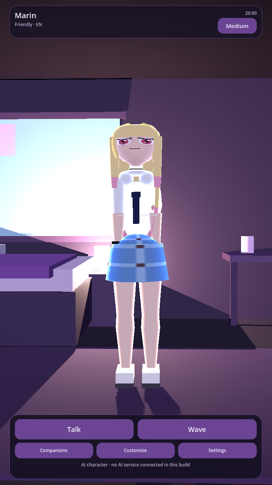
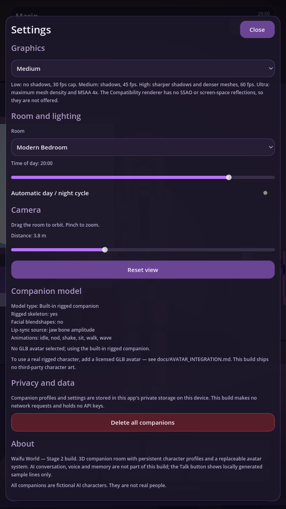
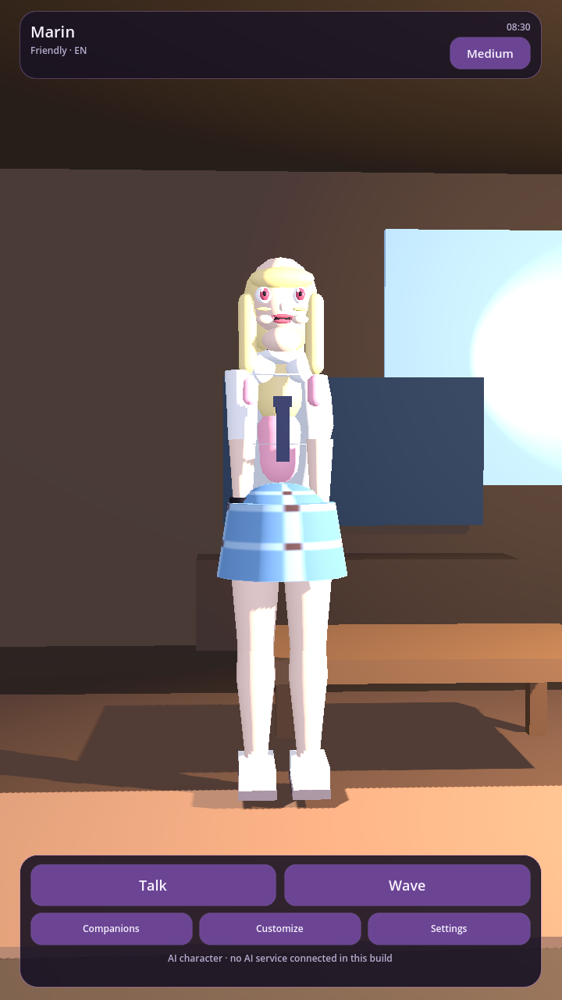

<div align="center">

<a href="https://github.com/technicalnihilist-lgtm/waifu-world/stargazers"></a>&nbsp;<a href="https://github.com/technicalnihilist-lgtm/waifu-world/network/members"></a>

<h3>Room-first 3D AI companion for Android — Godot 4, persistent character profiles, replaceable GLB…</h3>

  

<a href="https://github.com/technicalnihilist-lgtm/waifu-world/releases/latest"></a>

<b>Support the work</b>

  

<sub>Donations aren't live yet — Paytm, UPI, PayPal and Buy&nbsp;Me&nbsp;a&nbsp;Coffee all show <b>coming soon</b>. Until then, a ⭐ star is the best support.</sub>

<a href="https://github.com/technicalnihilist-lgtm/waifu-world/releases/latest"></a>  <a href="https://github.com/technicalnihilist-lgtm/waifu-world/releases"></a>

<h4>Get it from</h4>

<a href="https://github.com/technicalnihilist-lgtm/waifu-world/releases"></a> <a href="https://github.com/technicalnihilist-lgtm/waifu-world/archive/refs/heads/main.zip"></a>

</div>

---

---

## Honest status

| Area | State |
|---|---|
| 3D room, lighting, camera | Working. Data-driven room builder, day/night, orbit + pinch camera. |
| Companion character | **Rigged, animated and cel-shaded.** 20-bone `Skeleton3D`, one skinned mesh (per-vertex bone weights), keyframed clips (idle, wave, nod, shake, walk, sit). The **face is painted into a texture** (five expression variants) rather than modelled, and materials use Godot's toon ramp with rim light. Still a stylised low-poly figure — not a hand-sculpted model. |
| Character profiles | Working: create, name, select, edit, delete, persisted on device. |
| Replaceable GLB avatar loading | Working: GLB/glTF loading, capability detection, honest fallback. No third-party model ships (licensing). |
| Graphics presets | Working: low / medium / high / ultra, persisted, applied to shadows, MSAA, mesh density, light budget, frame cap. |
| Live weather | Working: Open-Meteo (keyless, CC BY 4.0) drives cloud cover, rain and storm lighting in the room, cached for offline use. |
| AI conversation | **Not implemented.** The Talk button shows a clearly labelled *local sample line*. It is not AI. |
| Voice input / TTS / lip-sync audio | **Not implemented.** The avatar can animate a mouth from an amplitude value, but nothing drives it yet. |
| Backend, accounts, memory, subscription | **Not implemented.** No network code, no API keys anywhere in this project. |
| Android APK | **A signed debug APK was built and signature-verified** (see [docs/ANDROID_BUILD.md](docs/ANDROID_BUILD.md)). It has **not** been launched on a phone or emulator — no device was available. No release/Play build exists. |

Nothing in this build pretends to be more than it is. Every "not implemented"
line above is a real gap, not a hidden mock.

---

## Requirements

- **Godot 4.3 or newer** (developed and tested with `4.3.stable`).
  `static var` and `Color.html_is_valid` require 4.1/4.2, so 4.2 may work but
  is untested.
- Android export templates matching your Godot version (only needed to build
  an APK).
- Android SDK + JDK configured in the Godot editor (only for APK export).
- Target device: Android 10 (API 29) or newer, 4 GB RAM class hardware.
  Compatibility renderer, portrait only.

## Run on desktop

```
godot --path .              # or open project.godot in the editor and press F5
```

Mouse acts as a finger (`emulate_touch_from_mouse` is on), so drag to orbit,
mouse wheel to zoom.

## Run the tests

```
godot --headless --path . --import          # first time only, builds the class cache
godot --headless --path . tests/test_runner.tscn
```

The runner exits with code `0` when every assertion passes and `1` otherwise.
Latest result: **591 assertions passed, 0 failed, 7 suites**.
See [docs/TESTING.md](docs/TESTING.md) for what is and is not covered.

## Build an APK

```bash
ANDROID_HOME=/path/to/android-sdk JAVA_HOME=/path/to/jdk-17 \
KEYSTORE=~/debug.keystore ./tools/build_android.sh build/WaifuWorld.apk
```

`tools/build_android.sh` is the exact recipe that produced the APK for this
stage on Godot 4.3.stable: it configures the editor settings Godot reads at
export time, imports the project, exports a debug APK and verifies the
signature. Full details, prerequisites and the device checklist are in
[docs/ANDROID_BUILD.md](docs/ANDROID_BUILD.md).

The APK itself is delivered alongside this source archive, not inside it.
It is a **debug** build signed with a throwaway debug keystore — installable for
testing, not publishable.

---

## Screenshots

Captured from the running app on a GitHub Actions runner (Xvfb + Mesa software
GL), not mocked up. See [docs/screenshots](docs/screenshots) for all six.

| Companion room (20:00) | Wave gesture |
|---|---|
|  |  |

| Companion list | Character editor |
|---|---|
|  |  |

| Settings | Living room at 08:30 |
|---|---|
|  |  |

Regenerate them any time with `godot --path . --resolution 720x1280 tools/capture_screens.tscn`,
or run the `screenshots` workflow on GitHub.

## What the app does

**Main room.** The companion stands in the middle of a furnished room. Two
translucent strips hold the controls so the 3D scene is never covered: the
companion's name and status on top, Talk / Wave / Companions / Customize /
Settings at the bottom.

**Companions screen.** Lists every saved profile with personality, voice, language
and creation date. Select, edit or delete (with confirmation). Create new
companions, up to 20.

**Editor.** Name, personality, voice preset, speech speed, pitch, language, hair
style, outfit, five colour fields, height, avatar model, reply length, memory
and emoji preferences. Cancel never writes anything; Save validates and
persists.

**Settings.** Graphics preset, room (bedroom / living room / apartment), time of
day slider, automatic day-night cycle, camera distance, a live capability
readout of the loaded avatar, **live weather** (Open-Meteo, with a refresh
button and offline fallback), a privacy section that can delete all companion
data, and a **Credits** section naming every component and its licence.

**The companion.** A rigged, cel-shaded anime figure: 20 bones, a skinned mesh whose vertices are weighted to those bones, keyframed clips, and a face painted into a texture so the eyes, lashes, brows and mouth read at any distance. Her look follows the reference sheet — long blonde hair with pink tips, white shirt, navy tie, blue plaid skirt, choker, white sneakers — as an original low-poly interpretation, not an official asset.

**Gestures and expressions.** Wave is a real joint animation. Expressions
(neutral, smile, sad, surprised, laugh, listening, thinking) drive brows, mouth
corners and eyelids.

---

## Project layout

```
WaifuWorld/
  project.godot
  icon.svg
  scenes/
    main.tscn                     # room root: Room + Lighting + CameraRig + AvatarLoader + UI
    ui/
      main_hud.tscn               # persistent overlay
      character_select.tscn
      character_editor.tscn
      settings_panel.tscn
  scripts/
    main.gd                       # application root / orchestration
    autoload/
      companions.gd               # autoload "Companions"  (extends CompanionRepository)
      app_settings.gd             # autoload "AppSettings" (extends SettingsRepository)
    core/
      json_file.gd                # atomic JSON read/write + corrupt-file backup
      companion_profile.gd        # profile model, validation, (de)serialisation
      companion_repository.gd     # profile CRUD + persistence
      settings_repository.gd      # settings persistence
      quality_presets.gd          # low/medium/high/ultra definitions
    avatar/
      avatar_catalog.gd           # discovers bundled + user-installed GLB avatars
      avatar_loader.gd            # loads GLB or falls back, plus the GLB adapter
      procedural_avatar.gd        # the built-in placeholder character
    world/
      room_presets.gd             # room data (furniture, colours, lighting anchors)
      room_builder.gd             # data -> 3D nodes with collision
      lighting_controller.gd      # day/night maths + application
      camera_rig.gd               # orbit / pinch / smooth follow
    ui/
      ui_theme.gd                 # colours, styleboxes, widget factories
      screen_manager.gd           # screen stack + Android back handling
      main_hud.gd
      character_select.gd
      character_editor.gd
      settings_panel.gd
  assets/
    avatars/avatars.json          # bundled avatar manifest (empty by default)
  tests/
    test_framework.gd
    test_runner.gd / test_runner.tscn
    suites/*.gd                   # 6 suites, 506 assertions
  docs/
    ARCHITECTURE.md
    CHARACTER_DATA.md
    AVATAR_INTEGRATION.md
    TESTING.md
    ANDROID_BUILD.md
    ROADMAP.md
    STAGE2_REPORT.md
```

## Where your data lives

```
user://profiles/companions.json      # every companion profile
user://settings/app_settings.json    # graphics, room, camera, day/night
user://avatars/                      # drop .glb + .json sidecar here to install an avatar
```

On Android these map to the app's private storage. Nothing is uploaded: this
build contains no networking code.

## Licence notes

All code here is original. **No third-party 3D character asset is bundled.**
The procedural avatar is generated at runtime from Godot primitives. If you add
a GLB character you must respect its licence and record it in the avatar
manifest (`author`, `license` fields) — see
[docs/AVATAR_INTEGRATION.md](docs/AVATAR_INTEGRATION.md).

---

## 🌍 Languages

<sub>Donations are <b>coming soon</b> in every language below — nothing to pay today, nothing to click.</sub>

<div align="center">

<sub><b>हिन्दी · বাংলা · मराठी · తెలుగు · தமிழ் · ગુજરાતી · ಕನ್ನಡ · മലയാളം · ਪੰਜਾਬੀ · ଓଡ଼ିଆ · অসমীয়া · اردو</b></sub>

</div>

<details>
<summary><b>🌍 Open the same message in 53 languages</b></summary>

**🇮🇳 Indian languages**

- **हिन्दी** (Hindi) — ☕ जल्द ही आ रहा है। · ⭐ अगर आपको यह ऐप और हमारा काम पसंद है, तो कृपया रिपॉजिटरी को स्टार दें और हमें फॉलो करें।
- **বাংলা** (Bengali) — ☕ খুব শিগগিরই আসছে। · ⭐ যদি আপনার এই অ্যাপ এবং আমাদের কাজ ভালো লাগে, তবে অনুগ্রহ করে রিপোজিটরিটিকে একটি স্টার দিন এবং আমাদের ফলো করুন।
- **मराठी** (Marathi) — ☕ लवकरच येत आहे. · ⭐ जर तुम्हाला हे ॲप आणि आमचं काम आवडलं असेल, तर कृपया रिपॉझिटरीला स्टार द्या आणि आम्हाला फॉलो करा.
- **తెలుగు** (Telugu) — ☕ త్వరలో రాబోతోంది. · ⭐ మీకు ఈ యాప్, మా పని నచ్చితే, దయచేసి రిపోజిటరీకి ఒక స్టార్ ఇచ్చి మమ్మల్ని ఫాలో అవ్వండి.
- **தமிழ்** (Tamil) — ☕ விரைவில் வருகிறது. · ⭐ உங்களுக்கு இந்த ஆப்பும் எங்க வேலையும் பிடிச்சிருந்தா, தயவுசெஞ்சு இந்த ரெபாசிட்டரிக்கு ஒரு ஸ்டார்…
- **ગુજરાતી** (Gujarati) — ☕ ટૂંક સમયમાં આવી રહ્યું છે. · ⭐ જો તમને આ એપ અને અમારું કામ ગમતું હોય, તો પ્લીઝ રિપોઝિટરીને સ્ટાર આપો અને અમને ફોલો કરો.
- **ಕನ್ನಡ** (Kannada) — ☕ ಶೀಘ್ರದಲ್ಲೇ ಬರುತ್ತಿದೆ. · ⭐ ನಿಮಗೆ ಈ ಆ್ಯಪ್ ಮತ್ತು ನಮ್ಮ ಕೆಲಸ ಇಷ್ಟವಾದರೆ, ದಯವಿಟ್ಟು ರೆಪೊಸಿಟರಿಗೆ ಸ್ಟಾರ್ ಕೊಡಿ ಮತ್ತು ನಮ್ಮನ್ನು ಫಾಲೋ ಮಾಡಿ.
- **മലയാളം** (Malayalam) — ☕ ഉടൻ വരുന്നു. · ⭐ നിങ്ങൾക്ക് ഈ ആപ്പും ഞങ്ങളുടെ പ്രവർത്തനവും ഇഷ്ടപ്പെട്ടെങ്കിൽ, ദയവായി റെപ്പോസിറ്ററിക്ക് ഒരു സ്റ്റാർ…
- **ਪੰਜਾਬੀ** (Punjabi) — ☕ ਜਲਦੀ ਆ ਰਿਹਾ ਹੈ। · ⭐ ਜੇ ਤੁਹਾਨੂੰ ਇਹ ਐਪ ਅਤੇ ਸਾਡਾ ਕੰਮ ਪਸੰਦ ਹੈ, ਤਾਂ ਕਿਰਪਾ ਕਰਕੇ ਰਿਪੋਜ਼ਟਰੀ ਨੂੰ ਸਟਾਰ ਦਿਓ ਅਤੇ ਸਾਨੂੰ ਫਾਲੋ ਕਰੋ।
- **ଓଡ଼ିଆ** (Odia) — ☕ ଖୁବ୍ ଶୀଘ୍ର ଆସୁଛି। · ⭐ ଯଦି ଆପଣଙ୍କୁ ଏହି ଆପ୍ ଏବଂ ଆମର କାମ ଭଲ ଲାଗୁଛି, ତେବେ ଦୟାକରି ରିପୋଜିଟୋରୀକୁ ଗୋଟିଏ ଷ୍ଟାର୍ ଦିଅନ୍ତୁ ଏବଂ ଆମକୁ ଫଲୋ କରନ୍ତୁ।
- **অসমীয়া** (Assamese) — ☕ অতি সোনকালেই আহি আছে। · ⭐ যদি আপুনি এই এপটো আৰু আমাৰ কাম ভাল পায়, তেন্তে অনুগ্ৰহ কৰি ৰিপজিটৰীটোক এটা ষ্টাৰ দিয়ক আৰু আমাক ফ'ল' কৰক।
- **اردو** (Urdu) — ☕ جلد آرہا ہے۔ · ⭐ اگر آپ کو یہ ایپ اور ہمارا کام پسند آئے تو براہ کرم ریپازٹری کو سٹار دیں اور ہمیں فالو کریں۔
- **संस्कृतम्** (Sanskrit) — ☕ शीघ्रमेव आगच्छति।
- **मैथिली** (Maithili) — ☕ जल्दिये आबि रहल अछि।
- **कोंकणी** (Konkani) — ☕ रोखडेंच येता.
- **کٲشُر** (Kashmiri) — ☕ جَلدی یِوان چھُ۔
- **سنڌي** (Sindhi) — ☕ जल्द अची रह्यो आहे।
- **डोगरी** (Dogri) — ☕ जल्दी आ करदा ऐ।
- **ꯃꯤꯇꯩ ꯂꯣꯟ** (Manipuri) — ☕ ꯑꯊꯨꯕꯥ ꯃꯇꯝꯗꯥ ꯂꯥꯛꯀꯅꯤ꯫
- **बर’** (Bodo) — ☕ थाबैनो फैगोन।
- **ᱥᱟᱱᱛᱟᱲᱤ** (Santali) — ☕ ᱞᱚᱜᱚᱱ ᱦᱤᱡᱩᱜ ᱠᱟᱱᱟ᱾
- **नेपाली** (Nepali) — ☕ छिट्टै आउँदैछ। · ⭐ यदि तपाईंलाई यो एप र हाम्रो काम मन पर्‍यो भने, कृपया रिपोजिटरीलाई स्टार दिनुहोस् र हामीलाई फलो गर्नुहोस्।

**🌍 World languages**

- **العربية** (Arabic) — ☕ قريبًا. · ⭐ إذا أعجبك هذا التطبيق وعملنا، فيرجى منح المستودع نجمة ومتابعتنا.
- **简体中文** (Chinese (Simplified)) — ☕ 即将推出。
- **繁體中文** (Chinese (Traditional)) — ☕ 即將推出。
- **Čeština** (Czech) — ☕ Již brzy.
- **Dansk** (Danish) — ☕ Kommer snart.
- **Nederlands** (Dutch) — ☕ Binnenkort beschikbaar. · ⭐ Vind je deze app en ons werk leuk?
- **Filipino** (Filipino) — ☕ Malapit na.
- **Suomi** (Finnish) — ☕ Tulossa pian.
- **Français** (French) — ☕ Bientôt disponible. · ⭐ Si cette application et notre travail vous plaisent, mettez une étoile au dépôt et suivez-nous.
- **Deutsch** (German) — ☕ Bald verfügbar. · ⭐ Wenn dir diese App und unsere Arbeit gefallen, gib dem Repository einen Stern und folge uns.
- **Ελληνικά** (Greek) — ☕ Έρχεται σύντομα.
- **עברית** (Hebrew) — ☕ בקרוב.
- **Magyar** (Hungarian) — ☕ Hamarosan.
- **Bahasa Indonesia** (Indonesian) — ☕ Segera hadir. · ⭐ Jika kamu suka aplikasi ini dan karya kami, beri bintang pada repositori ini dan ikuti kami.
- **Italiano** (Italian) — ☕ In arrivo.
- **日本語** (Japanese) — ☕ 近日公開。 · ⭐ このアプリと私たちの仕事が気に入ったら、リポジトリにスターを付けてフォローしてください。
- **한국어** (Korean) — ☕ 곧 공개됩니다. · ⭐ 이 앱과 저희 작업이 마음에 드신다면 저장소에 스타를 눌러 주시고 팔로우해 주세요.
- **Bahasa Melayu** (Malay) — ☕ Akan datang.
- **Norsk** (Norwegian) — ☕ Kommer snart.
- **فارسی** (Persian) — ☕ به‌زودی.
- **Polski** (Polish) — ☕ Wkrótce. · ⭐ Jeśli podoba Ci się ta aplikacja i nasza praca, daj repozytorium gwiazdkę i obserwuj nas.
- **Português** (Portuguese) — ☕ Em breve.
- **Română** (Romanian) — ☕ În curând.
- **Русский** (Russian) — ☕ Скоро. · ⭐ Если вам нравится это приложение и наша работа, поставьте звёздочку репозиторию и подпишитесь на нас.
- **Español** (Spanish) — ☕ Muy pronto. · ⭐ Si te gusta esta app y nuestro trabajo, dale una estrella al repositorio y síguenos.
- **Kiswahili** (Swahili) — ☕ Inakuja hivi karibuni.
- **Svenska** (Swedish) — ☕ Kommer snart.
- **ไทย** (Thai) — ☕ เร็ว ๆ นี้
- **Türkçe** (Turkish) — ☕ Çok yakında.
- **Українська** (Ukrainian) — ☕ Незабаром.
- **Tiếng Việt** (Vietnamese) — ☕ Sắp ra mắt. · ⭐ Nếu bạn thích ứng dụng này và công việc của chúng tôi, hãy tặng kho lưu trữ một ngôi sao và theo…

</details>

