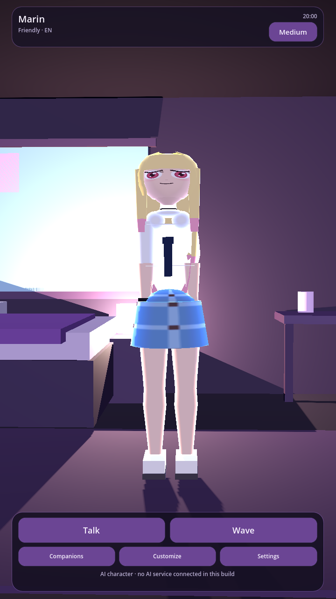
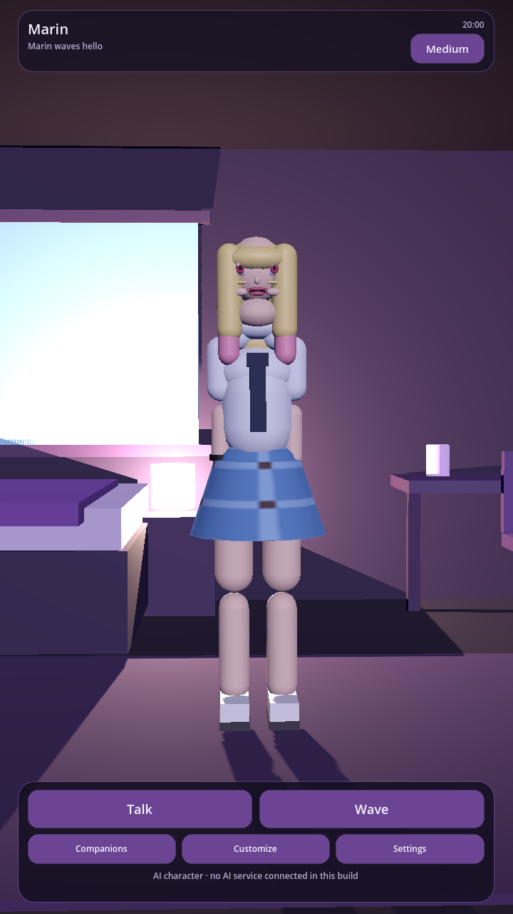
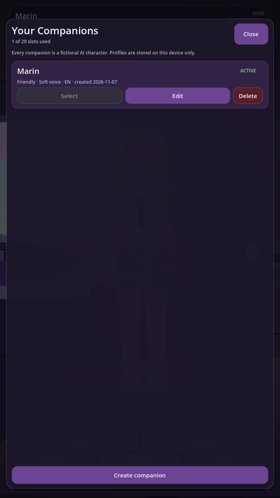
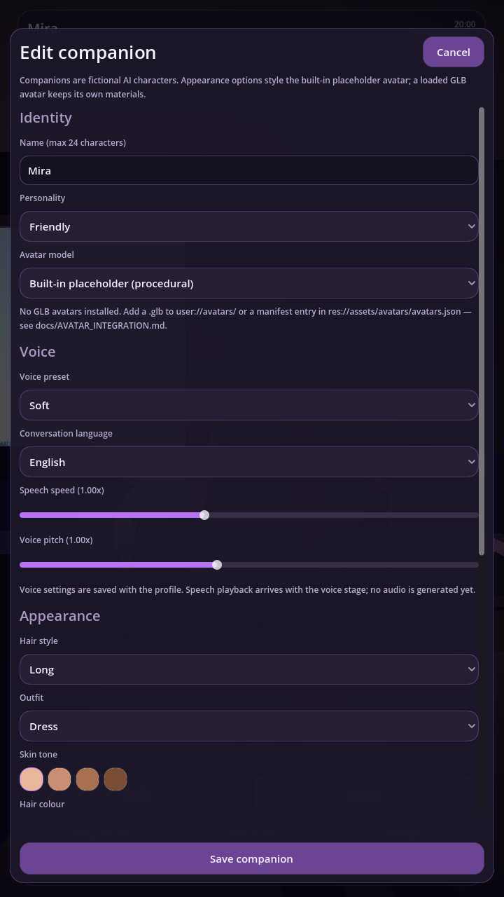
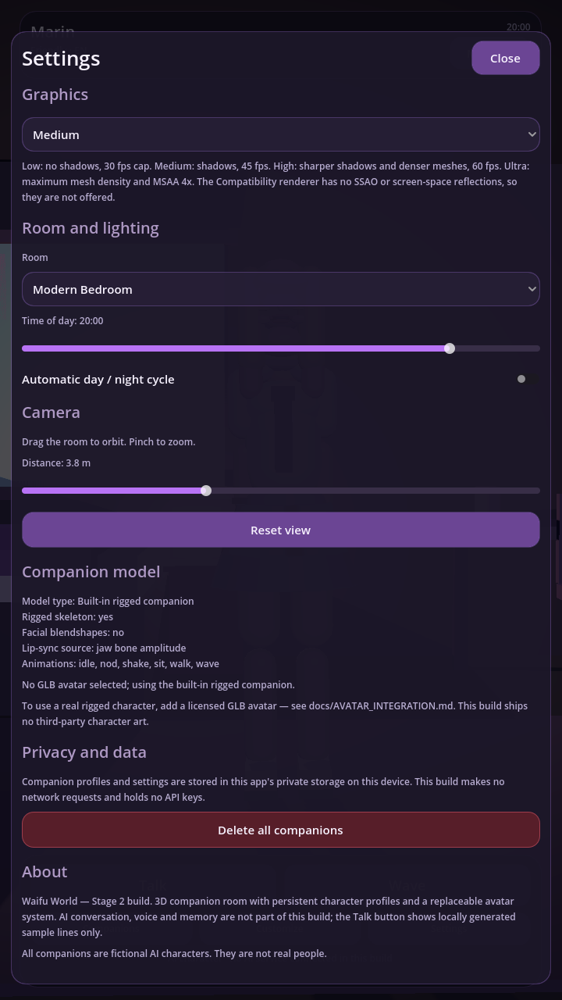
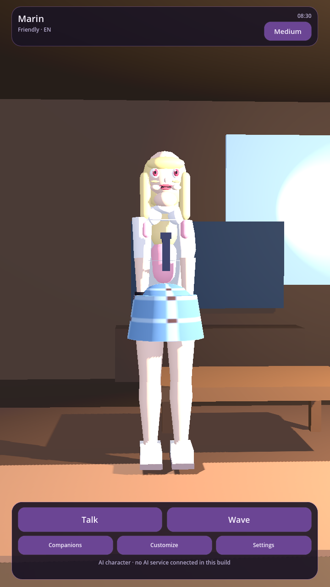

# Waifu World — Stage 2 (Godot 4, Android)

A room-first 3D AI companion app. You open the app and see your own companion
standing in a virtual room — not a chat window.

**Stage 2 delivers: persistent companion profiles, a complete character
management flow and a replaceable avatar loading system.** It also fixes the
defects found in the Stage 1 source. It does **not** contain an AI backend,
voice, memory or a production-quality human character; see
[Honest status](#honest-status) before reading anything else.

---

## Honest status

| Area | State |
|---|---|
| 3D room, lighting, camera | Working. Data-driven room builder, day/night, orbit + pinch camera. |
| Companion character | Working, but still a **procedural low-poly placeholder**. Real 3D facial blendshapes and a rigged human model are **not** included. |
| Character profiles | Working: create, name, select, edit, delete, persisted on device. |
| Replaceable GLB avatar loading | Working: GLB/glTF loading, capability detection, honest fallback. No third-party model ships (licensing). |
| Graphics presets | Working: low / medium / high / ultra, persisted, applied to shadows, MSAA, mesh density, light budget, frame cap. |
| AI conversation | **Not implemented.** The Talk button shows a clearly labelled *local sample line*. It is not AI. |
| Voice input / TTS / lip-sync audio | **Not implemented.** The avatar can animate a mouth from an amplitude value, but nothing drives it yet. |
| Backend, accounts, memory, subscription | **Not implemented.** No network code, no API keys anywhere in this project. |
| Android APK | **A signed debug APK was built and signature-verified** (see [docs/ANDROID_BUILD.md](docs/ANDROID_BUILD.md)). It has **not** been launched on a phone or emulator — no device was available. No release/Play build exists. |

Nothing in this build pretends to be more than it is. Every "not implemented"
line above is a real gap, not a hidden mock.

---

## Requirements

- **Godot 4.3 or newer** (developed and tested with `4.3.stable`).
  `static var` and `Color.html_is_valid` require 4.1/4.2, so 4.2 may work but
  is untested.
- Android export templates matching your Godot version (only needed to build
  an APK).
- Android SDK + JDK configured in the Godot editor (only for APK export).
- Target device: Android 10 (API 29) or newer, 4 GB RAM class hardware.
  Compatibility renderer, portrait only.

## Run on desktop

```
godot --path .              # or open project.godot in the editor and press F5
```

Mouse acts as a finger (`emulate_touch_from_mouse` is on), so drag to orbit,
mouse wheel to zoom.

## Run the tests

```
godot --headless --path . --import          # first time only, builds the class cache
godot --headless --path . tests/test_runner.tscn
```

The runner exits with code `0` when every assertion passes and `1` otherwise.
Latest result: **507 assertions passed, 0 failed, 6 suites**.
See [docs/TESTING.md](docs/TESTING.md) for what is and is not covered.

## Build an APK

```bash
ANDROID_HOME=/path/to/android-sdk JAVA_HOME=/path/to/jdk-17 \
KEYSTORE=~/debug.keystore ./tools/build_android.sh build/WaifuWorld.apk
```

`tools/build_android.sh` is the exact recipe that produced the APK for this
stage on Godot 4.3.stable: it configures the editor settings Godot reads at
export time, imports the project, exports a debug APK and verifies the
signature. Full details, prerequisites and the device checklist are in
[docs/ANDROID_BUILD.md](docs/ANDROID_BUILD.md).

The APK itself is delivered alongside this source archive, not inside it.
It is a **debug** build signed with a throwaway debug keystore — installable for
testing, not publishable.

---

## Screenshots

Captured from the running app on a GitHub Actions runner (Xvfb + Mesa software
GL), not mocked up. See [docs/screenshots](docs/screenshots) for all six.

| Companion room (20:00) | Wave gesture |
|---|---|
|  |  |

| Companion list | Character editor |
|---|---|
|  |  |

| Settings | Living room at 08:30 |
|---|---|
|  |  |

Regenerate them any time with `godot --path . --resolution 720x1280 tools/capture_screens.tscn`,
or run the `screenshots` workflow on GitHub.

## What the app does

**Main room.** The companion stands in the middle of a furnished room. Two
translucent strips hold the controls so the 3D scene is never covered: the
companion's name and status on top, Talk / Wave / Companions / Customize /
Settings at the bottom.

**Companions screen.** Lists every saved profile with personality, voice, language
and creation date. Select, edit or delete (with confirmation). Create new
companions, up to 20.

**Editor.** Name, personality, voice preset, speech speed, pitch, language, hair
style, outfit, five colour fields, height, avatar model, reply length, memory
and emoji preferences. Cancel never writes anything; Save validates and
persists.

**Settings.** Graphics preset, room (bedroom / living room / apartment), time of
day slider, automatic day-night cycle, camera distance, a live capability
readout of the loaded avatar, and a privacy section that can delete all
companion data.

**Gestures and expressions.** Wave is a real joint animation. Expressions
(neutral, smile, sad, surprised, laugh, listening, thinking) drive brows, mouth
corners and eyelids.

---

## Project layout

```
WaifuWorld/
  project.godot
  icon.svg
  scenes/
    main.tscn                     # room root: Room + Lighting + CameraRig + AvatarLoader + UI
    ui/
      main_hud.tscn               # persistent overlay
      character_select.tscn
      character_editor.tscn
      settings_panel.tscn
  scripts/
    main.gd                       # application root / orchestration
    autoload/
      companions.gd               # autoload "Companions"  (extends CompanionRepository)
      app_settings.gd             # autoload "AppSettings" (extends SettingsRepository)
    core/
      json_file.gd                # atomic JSON read/write + corrupt-file backup
      companion_profile.gd        # profile model, validation, (de)serialisation
      companion_repository.gd     # profile CRUD + persistence
      settings_repository.gd      # settings persistence
      quality_presets.gd          # low/medium/high/ultra definitions
    avatar/
      avatar_catalog.gd           # discovers bundled + user-installed GLB avatars
      avatar_loader.gd            # loads GLB or falls back, plus the GLB adapter
      procedural_avatar.gd        # the built-in placeholder character
    world/
      room_presets.gd             # room data (furniture, colours, lighting anchors)
      room_builder.gd             # data -> 3D nodes with collision
      lighting_controller.gd      # day/night maths + application
      camera_rig.gd               # orbit / pinch / smooth follow
    ui/
      ui_theme.gd                 # colours, styleboxes, widget factories
      screen_manager.gd           # screen stack + Android back handling
      main_hud.gd
      character_select.gd
      character_editor.gd
      settings_panel.gd
  assets/
    avatars/avatars.json          # bundled avatar manifest (empty by default)
  tests/
    test_framework.gd
    test_runner.gd / test_runner.tscn
    suites/*.gd                   # 6 suites, 506 assertions
  docs/
    ARCHITECTURE.md
    CHARACTER_DATA.md
    AVATAR_INTEGRATION.md
    TESTING.md
    ANDROID_BUILD.md
    ROADMAP.md
    STAGE2_REPORT.md
```

## Where your data lives

```
user://profiles/companions.json      # every companion profile
user://settings/app_settings.json    # graphics, room, camera, day/night
user://avatars/                      # drop .glb + .json sidecar here to install an avatar
```

On Android these map to the app's private storage. Nothing is uploaded: this
build contains no networking code.

## Licence notes

All code here is original. **No third-party 3D character asset is bundled.**
The procedural avatar is generated at runtime from Godot primitives. If you add
a GLB character you must respect its licence and record it in the avatar
manifest (`author`, `license` fields) — see
[docs/AVATAR_INTEGRATION.md](docs/AVATAR_INTEGRATION.md).
